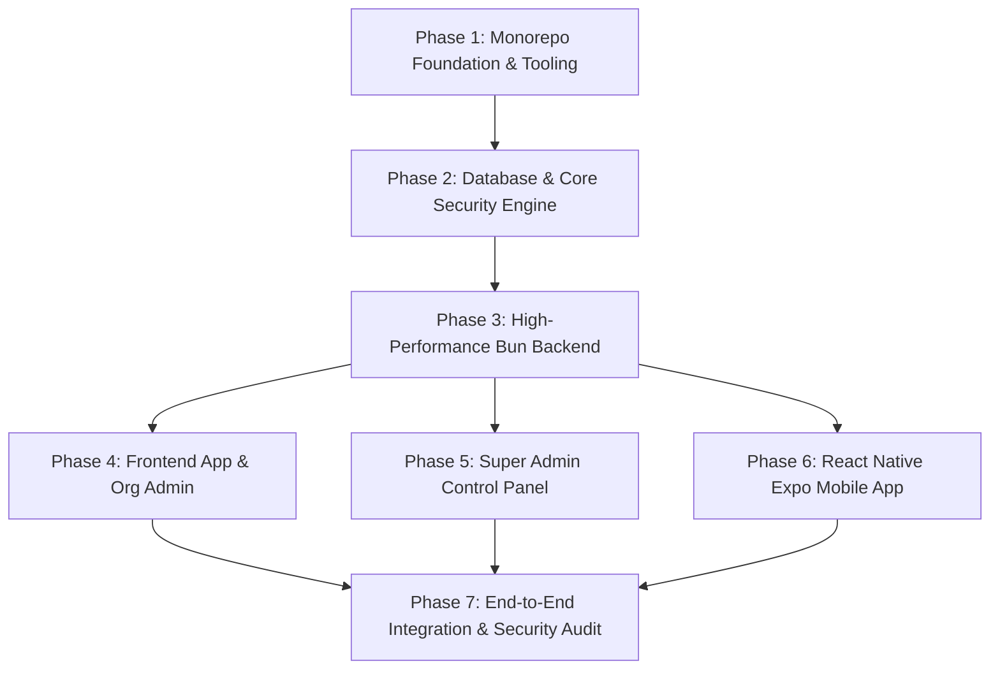

# Production Architecture & Setup Plan: Enterprise Multi-Tier SaaS Ecosystem

A robust, enterprise-grade architecture plan designed with a **Zero-Trust Security Model**, optimized **Data Structures**, and modern framework versions for a unified multi-platform system:

- **Super Admin**: High-privilege management portal (isolated administrative domain)
- **Frontend**: Customer/Tenant web platform featuring a scoped Organization Admin (`/admin`) and Client Dashboard
- **Backend**: High-throughput Bun runtime API service with end-to-end type safety
- **Database**: MongoDB with multi-tenant partitioned schema, compound indexing, and strict validation
- **Application**: Cross-platform React Native Mobile App powered by Expo (New Architecture)

---

## 1. High-Level Architecture & Monorepo Strategy

To maintain clean separation of concerns while sharing validation logic, types, and configurations, the project is organized as a **Turborepo Monorepo** powered by **Bun Workspaces**.

```
SAAS SETUP/
├── super-admin/              # Next.js 15+ (App Router, shadcn/ui, Super Admin control)
├── backend/                  # Bun + Elysia.js / Hono API Service
├── frontend/                 # Next.js 15+ (App Router, Customer App + Org Admin)
│   ├── src/app/
│   │   ├── (auth)/           # Authentication routes (Sign-in, Sign-up, Reset)
│   │   ├── (dashboard)/      # Customer/User facing experience
│   │   └── admin/            # Tenant/Organization Admin control panel
├── application/              # React Native Expo Mobile App (iOS / Android)
├── packages/
│   ├── database/             # MongoDB connection, Mongoose models, Index definitions
│   ├── types/                # Shared TypeScript contracts, DTOs, RBAC definitions
│   ├── validation/           # Zod schemas shared across API, Web, and Mobile
│   ├── security/             # Crypto utilities, JWT verify, password hashing (Argon2id)
│   ├── config-eslint/        # Shared ESLint & code quality rules
│   └── config-typescript/    # Strict TSConfig presets
├── turbo.json                # Turborepo task pipeline configuration
├── package.json              # Monorepo root package definition
└── bun.lock                  # Lockfile
```

---

## 2. Technology Stack & Framework Matrix

| Layer | Technology | Version | Rationale |
| :--- | :--- | :--- | :--- |
| **Package Manager & Runtime** | [Bun](https://bun.sh/) | `v1.2+` | Ultra-fast JS/TS runtime, native bundler, native package manager, and test runner. |
| **Monorepo Engine** | [Turborepo](https://turbo.build/) | `v2.x` | Incremental builds, remote caching, parallel task execution across packages. |
| **Super Admin Web** | [Next.js](https://nextjs.org/) + [React](https://react.dev/) | `v15.x` / `React 19` | App Router, Server Components (RSC), Turbopack, standalone isolation. |
| **Frontend Web** | [Next.js](https://nextjs.org/) + [React](https://react.dev/) | `v15.x` / `React 19` | High performance, SEO friendly, dynamic routing for Tenant `/admin` and user portal. |
| **UI Design System** | [shadcn/ui](https://ui.shadcn.com/) + [Tailwind CSS](https://tailwindcss.com/) | Radix UI Primitives + Tailwind v3.4/v4 | Accessible, headless, zero-bloat customizable design system. |
| **Backend API** | [Bun](https://bun.sh/) + [Elysia.js](https://elysiajs.com/) or [Hono](https://hono.dev/) | Latest | 4x faster than Express/Fastify, built-in OpenAPI/Swagger, native Eden Treaty (type-safe RPC). |
| **Database** | [MongoDB](https://www.mongodb.com/) (Replica Set) + [Mongoose](https://mongoosejs.com/) | `v8.x` | Document flexibility, high write performance, ACID multi-document transactions. |
| **Cache & Ephemeral Store** | [Redis](https://redis.io/) (via `ioredis`) | `v7.x+` | Rate limiting sliding window, distributed locks, revocable session blacklist. |
| **Mobile App** | [Expo](https://expo.dev/) (React Native) | `SDK 52+` (RN 0.76+) | React Native New Architecture (TurboModules), Expo Router v4, NativeWind v4 (Tailwind). |
| **Contract Validation** | [Zod](https://zod.dev/) | `v3.23+` | Single source of truth for runtime validation and static TypeScript inference. |

---

## 3. Comprehensive Cybersecurity Blueprint

### 3.1. Zero-Trust Authentication Architecture
1. **Separation of Authentication Realms**:
   - **Super Admin Realm**: Isolated authentication endpoint (`/api/v1/auth/super-admin/login`). Enforces mandatory hardware/TOTP Multi-Factor Authentication (RFC 6238). IP whitelisting configurable via reverse proxy.
   - **Tenant & User Realm**: Standard Multi-tenant auth (`/api/v1/auth/login`) supporting passwordless magic link, OAuth2 (Google, GitHub, Apple), and standard credentials.
2. **Token Security Model**:
   - **Access Token**: Short-lived (10–15 minutes), signed using asymmetric RS256 or Ed25519 keys (enables public-key verification without sharing secret keys with frontend).
   - **Refresh Token**: Long-lived (7–30 days), stored in MongoDB as an Argon2id hash.
   - **Web Storage**: Tokens transmitted via `HttpOnly`, `Secure`, `SameSite=Strict`, `Partitioned` cookies. Protects against Cross-Site Scripting (XSS).
   - **Mobile Storage**: Stored in hardware-backed secure storage using `expo-secure-store` (iOS Keychain / Android Keystore).
   - **Refresh Token Rotation & Fingerprinting**: Automatic detection of token reuse. If a revoked refresh token is presented, the entire token family is immediately invalidated.

### 3.2. Authorization & Granular Access Control
- **Role Hierarchy**:
  ```
  SUPER_ADMIN (System wide)
     └── ORG_OWNER (Tenant specific)
            └── ORG_ADMIN (Management of users, billing, integrations)
                   └── ORG_MEMBER (Standard operational access)
                          └── GUEST / READONLY
  ```
- **Permission Bitmasks / RBAC Engine**:
  - Permissions declared as string unions (`org:users:invite`, `billing:manage`, `audit:read`).
  - Contextual Guard Middleware: Every request requires an active Tenant ID header (`x-tenant-id` or route param) verified against the user's membership table.

### 3.3. Injection & NoSQL Security
- **Strict Zod Input Parsing**: Every payload is stripped of unknown keys (`strip` mode). Direct injection of MongoDB operators like `{"$gt": ""}` is rejected at the API boundary before hitting Mongoose.
- **BSON Type Validation**: Explicit casting of hex strings to `mongoose.Types.ObjectId` using validation middleware.
- **Sanitization**: All input strings sanitized to strip script tags and control characters.

### 3.4. API Hardening & Network Defenses
- **Adaptive Rate Limiting**: Redis-backed sliding-window counter:
  - Auth routes: 5 attempts per 15 minutes per IP.
  - Public endpoints: 60 requests per minute.
  - Authenticated API: 300 requests per minute per tenant.
- **Security Headers**:
  - `Content-Security-Policy (CSP)`: Strict nonce-based CSP; no `unsafe-inline` or `unsafe-eval`.
  - `Strict-Transport-Security (HSTS)`: `max-age=63072000; includeSubDomains; preload`.
  - `X-Frame-Options: DENY` (prevents Clickjacking).
  - `X-Content-Type-Options: nosniff`.
- **CORS Configuration**: Explicit origin whitelist strictly separating `super-admin.domain.com`, `app.domain.com`, and localhost ports. `Access-Control-Allow-Origin: *` is blocked.
- **Payload Limits**: Strict body parsers capping JSON payloads at 1MB, preventing Memory Exhaustion / DoS.

### 3.5. Audit Logging & Non-Repudiation
- **Immutable Event Log Collection**:
  - Captures: `timestamp`, `tenantId`, `actorId`, `actorRole`, `action`, `resource`, `ipAddress`, `userAgent`, and `diffSnapshot`.
  - TTL (Time-To-Live) indexing on operational logs; long-term compliance logs streamed to cold storage (e.g., S3/Glacier with object lock).

---

## 4. Data Structure & MongoDB Database Design

### 4.1. Tenancy Model: Logical Partitioning
Each collection leverages a compound index starting with `tenantId` to enforce strict query boundary isolation and optimal B-Tree performance.

```
+-------------------------------------------------------------+
|                      MongoDB Database                       |
+-------------------------------------------------------------+
   │
   ├── organizations (Tenants)
   │     ├── _id: ObjectId
   │     ├── name, slug (unique index)
   │     ├── subscription: { tier, status, stripeCustomerId }
   │     └── settings: { securityPolicy, mfaRequired }
   │
   ├── users (Global Identity)
   │     ├── _id: ObjectId
   │     ├── email: String (unique sparse index)
   │     ├── passwordHash: String (Argon2id)
   │     ├── isSuperAdmin: Boolean (sparse index)
   │     └── security: { mfaSecret, failedLoginAttempts, lockedUntil }
   │
   ├── memberships (User-Tenant Association)
   │     ├── _id: ObjectId
   │     ├── userId: ObjectId (ref: users)
   │     ├── tenantId: ObjectId (ref: organizations)
   │     ├── role: 'OWNER' | 'ADMIN' | 'MEMBER'
   │     └── permissions: [String]
   │     └── UNIQUE INDEX on (userId, tenantId)
   │
   ├── audit_logs (Time-Series / Bucket Pattern)
   │     ├── _id: ObjectId
   │     ├── tenantId: ObjectId (ref: organizations)
   │     ├── actor: { userId, email, role, ip }
   │     ├── event: String ('user.invited', 'billing.updated')
   │     ├── metadata: Object
   │     └── createdAt: Date (TTL Index: 365 days)
   │
   └── refresh_tokens (Session Store)
         ├── _id: ObjectId
         ├── userId: ObjectId
         ├── tokenHash: String
         ├── familyId: UUID
         ├── isRevoked: Boolean
         └── expiresAt: Date (TTL Index)
```

### 4.2. Indexing Strategy & Performance Rules
1. **Prefix Rule Compliance**: Every tenant-scoped query uses `{ tenantId: 1, createdAt: -1 }` or `{ tenantId: 1, status: 1 }` for index-only scans (Covered Queries).
2. **Partial & Sparse Indexes**:
   - `superAdmin`: Partial index `{ isSuperAdmin: 1 }` where `{ isSuperAdmin: true }` to keep index size minimal.
   - `slug`: Unique index `{ slug: 1 }` for fast multi-tenant subdomain resolution.
3. **Collation**: Case-insensitive collation (`locale: 'en', strength: 2`) configured at the index level for email lookups to prevent case duplication vulnerabilities.

---

## 5. Detailed Component Breakdown

### 5.1. `apps/super-admin/` (Super Admin Workspace)
- **Role**: Platform management, tenant provisioning, system health, audit logs, feature flags.
- **Tech**: Next.js 15 App Router, Tailwind CSS, shadcn/ui.
- **Security Features**:
  - Independent domain/subdomain (`admin.saas.com` or VPN/internal port).
  - Enforced 2FA/WebAuthn.
  - Session timeout after 15 minutes of inactivity.
  - Impersonation mode with cryptographic signature and full audit trail.

### 5.2. `apps/frontend/` (Customer Platform & Org Admin)
- **Role**: Customer-facing web dashboard + Organization management.
- **Structure**:
  - `app/(auth)/`: Sign-in, Register, Forgot Password, Accept Invite.
  - `app/(dashboard)/`: End-user SaaS application workspace.
  - `app/admin/`: Tenant Administrator panel (manage team members, roles, subscriptions, API keys, organization settings).
- **Tech**: Next.js 15 App Router, Tailwind CSS, shadcn/ui, TanStack Table (for data grids), Lucide Icons.

### 5.3. `apps/backend/` (Bun API Service)
- **Role**: High-throughput REST & WebSocket API.
- **Tech**: Bun + Elysia.js (or Hono) + Mongoose + Zod.
- **Features**:
  - End-to-end typed client export (Eden Treaty / Hono RPC).
  - OpenTelemetry metrics and structured Pino logging.
  - Swagger/OpenAPI interactive documentation at `/api/docs` (disabled in production).
  - Rate limiting, CORS, Helmet security middlewares.

### 5.4. `apps/application/` (React Native Mobile App)
- **Role**: Native mobile client for iOS and Android.
- **Tech**: Expo SDK 52+ with React Native 0.76+ (New Architecture enabled), Expo Router v4 (file-based routing), NativeWind v4 (Tailwind styling).
- **Security Features**:
  - Keychain / Keystore hardware token storage.
  - Biometric authentication (FaceID / Fingerprint via `expo-local-authentication`).
  - SSL Pinning protection for API communications in release builds.

### 5.5. `packages/*` (Shared Core Engine)
- `packages/database`: MongoDB connection pooling, Mongoose models, database seeds, and transactions.
- `packages/types`: All TypeScript interfaces, DTOs, API responses, and Enum definitions.
- `packages/validation`: Zod schemas for all requests (auth, user update, tenant settings, billing).
- `packages/security`: Crypto primitives, Argon2id hashing, JWT sign/verify, CSRF token validation.

---

## 6. Step-by-Step Implementation Roadmap



### Phase 1: Monorepo Foundation & Workspace Setup
1. Initialize root workspace with Bun and Turborepo (`turbo.json`, `package.json`).
2. Configure shared TypeScript configs (`packages/config-typescript`).
3. Set up code formatting and linting (`ESLint`, `Prettier`).

### Phase 2: Core Packages (Database, Types, Validation, Security)
1. Initialize `packages/types`: Define User, Tenant, Membership, Role, and Session interfaces.
2. Initialize `packages/validation`: Define reusable Zod schemas for authentication, pagination, and tenant administration.
3. Initialize `packages/security`: Implement Argon2id hashing, token generation (JWT), and encryption helpers.
4. Initialize `packages/database`: Create Mongoose client with automatic reconnect, schema definitions, and compound index specifications.

### Phase 3: Bun Backend Service (`apps/backend`)
1. Scaffold Bun application with Elysia.js (or Hono).
2. Attach core security middleware: Helmet, CORS, Rate Limiter, Body Parser limit, Error Handler.
3. Build Modular Controllers:
   - `/api/v1/auth`: Registration, Login, MFA, Refresh, Logout.
   - `/api/v1/super-admin`: Tenant management, metrics, audit logs.
   - `/api/v1/admin`: Organization settings, member management, invite links.
   - `/api/v1/app`: User dashboard features.
4. Generate Eden/OpenAPI client for automatic type consumption in web and mobile.

### Phase 4: Frontend Web Application (`apps/frontend`)
1. Scaffold Next.js 15 with App Router and Turbopack.
2. Configure Tailwind CSS and initialize shadcn/ui components (`button`, `card`, `dialog`, `form`, `table`, `dropdown-menu`, etc.).
3. Implement `app/(auth)` routes with React Hook Form + Zod resolvers.
4. Build `app/(dashboard)` for standard SaaS end-user workflows.
5. Build `app/admin` organization admin dashboard for tenant owners/admins.

### Phase 5: Super Admin Application (`apps/super-admin`)
1. Scaffold independent Next.js 15 project.
2. Configure specialized layout with administrative sidebar, tenant switcher, and system metrics.
3. Integrate real-time system monitoring, audit trail explorer, and user impersonation guard.
4. Enforce separate session cookie names (`__Host-SuperAdmin-Session`) to prevent session bleeding with customer web app.

### Phase 6: React Native Mobile Application (`apps/application`)
1. Initialize Expo SDK 52 project with TypeScript and Expo Router v4.
2. Configure NativeWind v4 (Tailwind for React Native).
3. Implement Secure Store token management and Biometric authentication gate.
4. Build mobile screens mirroring key SaaS workflows and notification center.

### Phase 7: Automated Security Auditing & Production Readiness
1. Dynamic & Static Security Analysis: Run `npm audit` / `bunx snyk` and linting rules.
2. Penetration test checks: Validate rate-limiting thresholds, CORS headers, NoSQL injection resistance, and CSRF protection.
3. Dockerization: Multi-stage Dockerfiles for Bun backend, Next.js standalone outputs, and static asset delivery.

---

## 7. Ready-to-Run Initialization Script

To start scaffolding this architecture immediately, run the following automated setup in your terminal:

```bash
# 1. Initialize Root Monorepo
bun init -y
bun add -d turbo typescript @types/node

# 2. Create Workspace Folders
mkdir -p apps/super-admin apps/frontend apps/backend apps/application
mkdir -p packages/database packages/types packages/validation packages/security

# 3. Create Shared Packages
# (Each package will have its own package.json linked via workspaces in root package.json)
```

*(Detailed commands for each sub-application are provided in the implementation phase.)*
