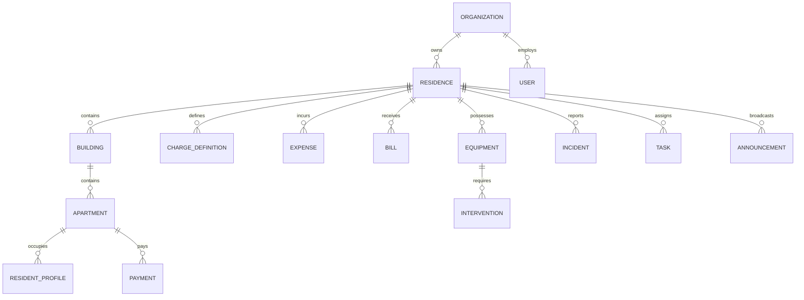

# Cité Connect — Residence Management Platform
## Master Technical & Product Architecture Plan

---

## 1. Executive Summary & Project Goal

**Cité Connect** is a high-performance multi-tenant management platform designed specifically for **AADL, LPA, LPP, private residences, housing complexes, and copropriétés**. 

The platform gives property administrators (syndics, management agencies, and resident associations) a single, unified operations hub to manage physical infrastructure, residents, operational expenses, service charges, maintenance incidents, on-site personnel, and communications.

> **Core Philosophy**: Cité Connect is an **operational and physical management system**, not a generic accounting/profit-oriented SaaS. It prioritizes action-oriented workflows, debt recovery, operational uptime, and transparency.

---

## 2. Monorepo Architecture & Technology Topology

The project is built on top of a high-throughput **Turborepo** + **Bun Workspaces** monorepo located in the workspace root.

```
c:\Users\MY PC\Desktop\Cité Connect/
├── super-admin/            # Next.js 15+ Platform Owner Portal (Port 3001)
├── frontend/               # Next.js 15+ Syndic & Property Manager Web Console (Port 3000)
├── application/            # React Native Expo Mobile App for Residents & Field Staff (Port 8081)
├── backend/                # Bun + Elysia.js Core REST/OpenAPI Service (Port 4000)
├── packages/
│   ├── database/           # MongoDB connection, Mongoose schemas & compound indexes
│   ├── types/              # Shared TypeScript contracts, DTOs, and RBAC definitions
│   ├── validation/         # Shared Zod schemas & input sanitizers
│   ├── security/           # Argon2id, JWT/Ed25519 tokens, and crypto utilities
│   └── config-typescript/  # Shared TSConfig presets
├── turbo.json              # Turborepo task pipeline
└── package.json            # Root workspace configuration
```

### Component Roles & Responsibility Matrix

| Sub-Project | Port / Runtime | Target Audience | Primary Responsibilities |
| :--- | :--- | :--- | :--- |
| **[`backend`](file:///c:/Users/MY%20PC/Desktop/Cit%C3%A9%20Connect/backend)** | Port 4000<br>Bun + Elysia.js | All clients | Core API, financial calculations, overdue charges computation, authentication, audit logging, file upload handlers, and OpenAPI documentation (`/docs`). |
| **[`frontend`](file:///c:/Users/MY%20PC/Desktop/Cit%C3%A9%20Connect/frontend)** | Port 3000<br>Next.js 15 (App Router) | Syndics, Residence Managers, Building Admins | Web back-office for daily operations: residence setup, apartment tracking, financial reconciliation, maintenance tickets, staff dispatch, and reporting. |
| **[`super-admin`](file:///c:/Users/MY%20PC/Desktop/Cit%C3%A9%20Connect/super-admin)** | Port 3001<br>Next.js 15 (App Router) | Platform Super Admins | Managing syndic organizations, approving onboarding requests, platform-wide metrics, system audit logs, and global master lookup templates. |
| **[`application`](file:///c:/Users/MY%20PC/Desktop/Cit%C3%A9%20Connect/application)** | Port 8081<br>React Native (Expo SDK 52) | Residents & On-site Staff | Resident self-service (check balance, payment history, submit incidents with camera photos, read announcements) + Concierge/Staff task checklist. |
| **[`packages/database`](file:///c:/Users/MY%20PC/Desktop/Cit%C3%A9%20Connect/packages/database)** | Bun / Node | Backend / Shared | Centralized Mongoose models with compound index partitioning (`{ organizationId: 1, residenceId: 1 }`). |
| **[`packages/types`](file:///c:/Users/MY%20PC/Desktop/Cit%C3%A9%20Connect/packages/types)** | TypeScript | All packages | Single source of truth for DTOs, API payloads, domain interfaces, and RBAC permissions. |
| **[`packages/validation`](file:///c:/Users/MY%20PC/Desktop/Cit%C3%A9%20Connect/packages/validation)** | Zod | Backend, Frontend, Mobile | Input validation schemas, Algerian phone/CCP format validators, query parsers. |
| **[`packages/security`](file:///c:/Users/MY%20PC/Desktop/Cit%C3%A9%20Connect/packages/security)** | Bun / Crypto | Backend | Password hashing (Argon2id), JWT access/refresh token generation, TOTP MFA, permission checks. |

---

## 3. Multi-Tenancy & Data Boundary Model

To fit the existing SaaS infrastructure seamlessly, tenancy is partitioned logically:

1. **Organization (The Tenant)**:
   * Represents a **Property Management Company (Syndic)**, a **Real Estate Office**, or a **Copropriété Board**.
   * One Organization can manage one or many Residences.
2. **Residence (The Physical Asset)**:
   * Belongs to an Organization.
   * Can be an AADL cité, LPA site, private gated community, or single co-ownership complex.
3. **Compound Index Partitioning**:
   * Every document in MongoDB carries `organizationId: ObjectId` and (where applicable) `residenceId: ObjectId`.
   * Queries are indexed: `{ organizationId: 1, residenceId: 1, ... }` ensuring strict tenant boundary isolation and instant index-covered lookups.

---

## 4. Role-Based Access Control (RBAC)

Updating the generic roles in [`packages/types/src/index.ts`](file:///c:/Users/MY%20PC/Desktop/Cit%C3%A9%20Connect/packages/types/src/index.ts) to match the residence domain:

```typescript
export type SystemRole = 'SUPER_ADMIN' | 'USER';

export type ResidenceRole =
  | 'ORG_OWNER'           // Agency Owner / Head Syndic
  | 'RESIDENCE_MANAGER'   // Manager assigned to specific residences
  | 'BUILDING_MANAGER'    // Scoped manager for designated buildings
  | 'STAFF'               // Technicians, gardiens, concierges (tasks & incidents)
  | 'RESIDENT';           // Apartment tenant or owner
```

### Permission Matrix

| Role | Residences & Buildings | Finances & Charges | Maintenance & Incidents | Staff & Tasks | Announcements | Resident Portal |
| :--- | :---: | :---: | :---: | :---: | :---: | :---: |
| **SUPER_ADMIN** | Global View | Global View | Global View | Global View | Platform-wide | N/A |
| **ORG_OWNER** | Full CRUD | Full CRUD | Full CRUD | Full CRUD | Full CRUD | View all |
| **RESIDENCE_MANAGER** | Assigned Only | Assigned Only | Assigned Only | Assigned Only | Create/Publish | View assigned |
| **BUILDING_MANAGER** | Assigned Buildings | Read / Record payments | Assigned Buildings | View Assigned | View / Send local | View assigned |
| **STAFF / TECH** | Read Assigned | None | Update Assigned Tickets | Own Tasks Only | Read | None |
| **RESIDENT** | Read Own Unit Info | Read Own Dues / Receipts | Report & Track Own | None | Read | Own Profile Only |

---

## 5. Domain Data Model & Mongoose Schemas

All models reside in [`packages/database/src/models/`](file:///c:/Users/MY%20PC/Desktop/Cit%C3%A9%20Connect/packages/database/src/models).



### 5.1 Physical Infrastructure Schemas

* **`Residence`**:
  * `organizationId`: Ref -> Organization (Required, Indexed)
  * `name`: String (e.g. "Cité 1500 Logements AADL")
  * `code`: String (Unique identifier, slug)
  * `typeId`: Ref -> `LookupItem` (AADL, LPA, LPP, Private, Copropriété)
  * `location`:
    * `wilaya`: String (e.g. "Algiers", "Oran")
    * `commune`: String (e.g. "Bab Ezzouar")
    * `address`: String
    * `coordinates`: `{ lat: Number, lng: Number }` (optional)
  * `totalBuildings`: Number
  * `totalApartments`: Number
  * `status`: `'ACTIVE' | 'ARCHIVED'`
  * `settings`: `{ currency: 'DZD', defaultChargeDueDay: 5 }`
  * Timestamps & Soft Delete.

* **`Building`**:
  * `organizationId`: Ref -> Organization
  * `residenceId`: Ref -> Residence (Indexed)
  * `name`: String (e.g. "Bâtiment A1", "Bloc 12")
  * `floorsCount`: Number
  * `apartmentsCount`: Number
  * `description`: String
  * `status`: `'ACTIVE' | 'ARCHIVED'`

* **`Apartment`**:
  * `organizationId`: Ref -> Organization
  * `residenceId`: Ref -> Residence
  * `buildingId`: Ref -> Building (Indexed)
  * `number`: String (e.g. "Apt 04", "12B")
  * `floor`: Number
  * `type`: String (e.g. "F3", "F4", "Duplex")
  * `surfaceM2`: Number (optional)
  * `occupancyStatus`: `'OCCUPIED' | 'VACANT' | 'UNDER_MAINTENANCE'`
  * `currentResidentId`: Ref -> `ResidentProfile` (optional)
  * `monthlyChargeAmount`: Number (DZD)
  * `currentBalance`: Number (Calculated: positive = credit, negative = unpaid debt)

* **`ResidentProfile`**:
  * `organizationId`: Ref -> Organization
  * `residenceId`: Ref -> Residence
  * `buildingId`: Ref -> Building
  * `apartmentId`: Ref -> Apartment (Indexed)
  * `userId`: Ref -> User (optional, links to auth account for mobile app login)
  * `fullName`: String
  * `phone`: String (Indexed)
  * `email`: String (optional)
  * `residentType`: `'OWNER' | 'TENANT'`
  * `occupancyStartDate`: Date
  * `occupancyEndDate`: Date (optional)
  * `emergencyContact`: `{ name: String, phone: String }`
  * `status`: `'ACTIVE' | 'ARCHIVED'`

---

### 5.2 Financial Management Schemas

* **`ChargeDefinition`**:
  * `organizationId`: Ref -> Organization
  * `residenceId`: Ref -> Residence
  * `title`: String (e.g. "Monthly Building Maintenance", "Cleaning & Waste")
  * `categoryTypeId`: Ref -> `LookupItem`
  * `amount`: Number (DZD)
  * `frequency`: `'MONTHLY' | 'QUARTERLY' | 'ANNUAL' | 'ONE_TIME'`
  * `appliesTo`: `'ALL' | 'BUILDING' | 'APARTMENT'`
  * `targetBuildingId`: Ref -> Building (optional)
  * `targetApartmentId`: Ref -> Apartment (optional)
  * `dueDay`: Number (1-31)
  * `status`: `'ACTIVE' | 'ARCHIVED'`

* **`Payment`**:
  * `organizationId`: Ref -> Organization
  * `residenceId`: Ref -> Residence
  * `apartmentId`: Ref -> Apartment (Indexed)
  * `residentId`: Ref -> ResidentProfile
  * `chargeDefinitionId`: Ref -> ChargeDefinition (optional)
  * `period`: String (e.g. "2026-03" for March 2026)
  * `amount`: Number (DZD)
  * `paymentDate`: Date
  * `paymentMethodId`: Ref -> `LookupItem` (Cash, CCP, Edahabia, CIB, Cheque, Bank Transfer)
  * `transactionReference`: String (e.g. CCP receipt receipt number)
  * `receiptNumber`: String (Auto-generated unique serial: e.g. `REC-2026-00452`)
  * `proofDocumentUrl`: String (Uploaded slip image/PDF)
  * `status`: `'VALIDATED' | 'PENDING' | 'CANCELLED'`
  * `collectedByUserId`: Ref -> User (Manager/cashier who logged payment)
  * `notes`: String

* **`Expense`**:
  * `organizationId`: Ref -> Organization
  * `residenceId`: Ref -> Residence
  * `buildingId`: Ref -> Building (optional, for building-specific expense)
  * `categoryId`: Ref -> `LookupItem` (Elevator maintenance, Gardening, Cleaning supplies, Security)
  * `amount`: Number (DZD)
  * `expenseDate`: Date
  * `supplier`: `{ name: String, phone: String, taxId: String }`
  * `paymentMethodId`: Ref -> `LookupItem`
  * `receiptUrl`: String (Invoice / Bon de caisse image/PDF)
  * `status`: `'PAID' | 'PENDING' | 'CANCELLED'`
  * `description`: String

* **`Bill`** (Utility & Contractual Bills):
  * `organizationId`: Ref -> Organization
  * `residenceId`: Ref -> Residence
  * `buildingId`: Ref -> Building (optional)
  * `serviceType`: Ref -> `LookupItem` (Sonelgaz Electricity, Water/SEAAL, Gas, Elevator Contract)
  * `providerName`: String (e.g. "Sonelgaz", "Algérienne des Eaux")
  * `referenceNumber`: String (Counter or Bill ref)
  * `billingPeriod`: String
  * `amount`: Number (DZD)
  * `dueDate`: Date
  * `paymentDate`: Date (optional)
  * `status`: `'UNPAID' | 'PAID' | 'OVERDUE'`
  * `documentUrl`: String

---

### 5.3 Maintenance, Incidents & Operations Schemas

* **`Equipment`**:
  * `organizationId`: Ref -> Organization
  * `residenceId`: Ref -> Residence
  * `buildingId`: Ref -> Building (optional)
  * `name`: String (e.g. "Elevator Bloc A", "Main Water Booster Pump")
  * `typeId`: Ref -> `LookupItem`
  * `brandModel`: String
  * `serialNumber`: String
  * `installationDate`: Date
  * `status`: `'OPERATIONAL' | 'DEGRADED' | 'OUT_OF_SERVICE' | 'UNDER_MAINTENANCE'`
  * `lastMaintenanceDate`: Date
  * `nextMaintenanceDate`: Date
  * `maintenanceContract`: `{ provider: String, contact: String, expiryDate: Date }`

* **`Incident`**:
  * `organizationId`: Ref -> Organization
  * `residenceId`: Ref -> Residence
  * `buildingId`: Ref -> Building (optional)
  * `apartmentId`: Ref -> Apartment (optional)
  * `typeId`: Ref -> `LookupItem` (Water leak, Electrical fault, Elevator stoppage, Waste accumulation)
  * `priority`: `'LOW' | 'MEDIUM' | 'HIGH' | 'CRITICAL'`
  * `title`: String
  * `description`: String
  * `reportedBy`: `{ residentId?: Ref, name: String, phone: String }`
  * `mediaUrls`: String[] (Photos / videos)
  * `status`: `'REPORTED' | 'ACKNOWLEDGED' | 'IN_PROGRESS' | 'RESOLVED' | 'CLOSED'`
  * `resolutionDetails`: String
  * `resolvedAt`: Date

* **`Intervention`** (Maintenance Tickets):
  * `organizationId`: Ref -> Organization
  * `residenceId`: Ref -> Residence
  * `incidentId`: Ref -> Incident (optional)
  * `equipmentId`: Ref -> Equipment (optional)
  * `buildingId`: Ref -> Building (optional)
  * `title`: String
  * `description`: String
  * `assignedStaffId`: Ref -> `StaffMember` (optional)
  * `externalTechnician`: `{ name: String, company: String, phone: String }` (optional)
  * `cost`: Number (DZD)
  * `priority`: `'LOW' | 'MEDIUM' | 'HIGH' | 'URGENT'`
  * `status`: `'NEW' | 'ASSIGNED' | 'IN_PROGRESS' | 'WAITING_PARTS' | 'RESOLVED' | 'CLOSED'`
  * `photosBefore`: String[]
  * `photosAfter`: String[]
  * `scheduledDate`: Date
  * `completedDate`: Date

---

### 5.4 Staff & Task Dispatch Schemas

* **`StaffMember`**:
  * `organizationId`: Ref -> Organization
  * `userId`: Ref -> User (optional, for app login)
  * `fullName`: String
  * `phone`: String
  * `functionId`: Ref -> `LookupItem` (Gardien/Concierge, Femme de ménage, Electrician, Plumber, Security)
  * `assignedResidences`: Ref -> Residence[]
  * `assignedBuildings`: Ref -> Building[]
  * `status`: `'ACTIVE' | 'ON_LEAVE' | 'TERMINATED'`
  * `contract`: `{ startDate: Date, endDate: Date, monthlySalary: Number }`

* **`Task`**:
  * `organizationId`: Ref -> Organization
  * `residenceId`: Ref -> Residence
  * `assignedTo`: Ref -> StaffMember
  * `title`: String
  * `description`: String
  * `priority`: `'LOW' | 'NORMAL' | 'HIGH' | 'URGENT'`
  * `deadline`: Date
  * `status`: `'PENDING' | 'IN_PROGRESS' | 'COMPLETED' | 'CANCELLED'`
  * `completionProof`: String (Photo)

---

### 5.5 Communication & Central Documents

* **`Announcement`**:
  * `organizationId`: Ref -> Organization
  * `residenceId`: Ref -> Residence
  * `targetScope`: `'ALL_RESIDENCE' | 'SPECIFIC_BUILDINGS' | 'SPECIFIC_APARTMENTS'`
  * `targetBuildingIds`: Ref -> Building[]
  * `title`: String
  * `content`: String
  * `category`: `'GENERAL' | 'MAINTENANCE_ALERT' | 'WATER_CUT' | 'CHARGES_REMINDER'`
  * `priority`: `'NORMAL' | 'URGENT'`
  * `publishedAt`: Date
  * `expiresAt`: Date
  * `channels`: `('IN_APP' | 'SMS' | 'WHATSAPP')[]`

* **`DocumentItem`**:
  * `organizationId`: Ref -> Organization
  * `residenceId`: Ref -> Residence
  * `attachedToType`: `'RESIDENCE' | 'BUILDING' | 'APARTMENT' | 'RESIDENT' | 'PAYMENT' | 'BILL' | 'EQUIPMENT'`
  * `attachedToId`: ObjectId
  * `title`: String
  * `fileUrl`: String
  * `fileType`: String (PDF, Image, Excel)
  * `fileSizeBytes`: Number
  * `uploadedBy`: Ref -> User

---

### 5.6 Dynamic Category Lookups (Section 21 Implementation)

To meet the mandatory requirement that **no lists are hard-coded**:

* **`LookupItem`**:
  * `organizationId`: Ref -> Organization (optional: null for system defaults)
  * `group`: 
    * `'RESIDENCE_TYPE'` (AADL, LPA, LPP, Private, Copropriété)
    * `'PAYMENT_METHOD'` (Cash, CCP, Edahabia, CIB, Cheque, Bank Transfer)
    * `'CHARGE_TYPE'` (Common maintenance, Cleaning, Security, Lift, Reserve)
    * `'EXPENSE_CATEGORY'` (Electricity, Plumbing, Repairs, Gardiennage)
    * `'BILL_TYPE'` (Sonelgaz, Water/SEAAL, Elevator Maintenance)
    * `'INCIDENT_TYPE'` (Water leak, Electrical fault, Elevator, Waste)
    * `'EQUIPMENT_TYPE'` (Elevator, Booster Pump, Generator, Fire Extinguisher)
    * `'STAFF_FUNCTION'` (Concierge, Cleaning agent, Electrician, Plumber)
  * `code`: String (Unique slug per group)
  * `label`: `{ fr: String, ar: String, en: String }`
  * `isSystem`: Boolean (Default presets vs custom created by syndic)
  * `order`: Number
  * `isActive`: Boolean

---

## 6. Core REST API Route Architecture (Elysia.js)

Implemented inside [`backend/src/routes/`](file:///c:/Users/MY%20PC/Desktop/Cit%C3%A9%20Connect/backend/src/routes).

### 6.1 Authentication & Profile (`/api/v1/auth`)
* `POST /login`: Username/password -> Access Token + Refresh Token (stores active role).
* `POST /refresh`: Token rotation.
* `POST /logout`: Invalidate session.
* `GET /me`: Returns profile, permissions, active residence context.

### 6.2 Residence & Infrastructure (`/api/v1/residences`)
* `GET /`: List all residences under current Organization (with apartment counts & dues summary).
* `POST /`: Create residence.
* `GET /:id`: Residence detail with buildings list and operational status.
* `PATCH /:id`: Edit residence details.
* `GET /:id/buildings`: List buildings in residence.
* `POST /:id/buildings`: Add building.
* `GET /:id/apartments`: List apartments (filtered by building, occupancy, payment status).
* `POST /:id/apartments`: Add apartment.
* `GET /:id/residents`: List resident occupants with contact info.
* `POST /:id/residents`: Register new occupant to an apartment.

### 6.3 Financial Management (`/api/v1/finances`)
* `GET /charges`: List configured charges.
* `POST /charges`: Create recurring/one-time charge.
* `POST /charges/generate-monthly`: Trigger monthly billing calculation for all occupied apartments.
* `GET /payments`: List payments with search, date filter, payment method, apartment filter.
* `POST /payments`: Record a resident payment (generates receipt serial number).
* `GET /payments/:id/receipt.pdf`: Generate downloadable payment receipt PDF.
* `GET /unpaid`: Dues aggregation engine (computes unpaid months, debts per apartment and building).
* `GET /expenses`: List expenses by category, building, and period.
* `POST /expenses`: Record new operational expense.
* `GET /bills`: List utility and provider bills with overdue indicators.
* `POST /bills`: Log new utility bill.
* `PATCH /bills/:id/pay`: Mark bill as paid.

### 6.4 Maintenance & Incidents (`/api/v1/maintenance`)
* `GET /incidents`: List reported incidents with status & severity.
* `POST /incidents`: Log new incident (used by managers and residents).
* `PATCH /incidents/:id/status`: Update incident status (e.g. Reported -> In Progress -> Resolved).
* `GET /interventions`: Maintenance tickets list.
* `POST /interventions`: Create intervention ticket & assign to staff or external vendor.
* `GET /equipment`: Equipment registry with maintenance schedules & alerts.
* `POST /equipment`: Register equipment item.

### 6.5 Staff & Tasks (`/api/v1/staff`)
* `GET /`: List employees, assigned buildings, and contracts.
* `POST /`: Add staff member.
* `GET /tasks`: List daily operational tasks.
* `POST /tasks`: Assign task with deadline.
* `PATCH /tasks/:id/complete`: Complete task with photo upload.

### 6.6 Resident Mobile API (`/api/v1/resident`)
* `GET /dashboard`: Summary of resident's apartment: current balance, next due date, announcements.
* `GET /charges`: Detailed breakdown of charges.
* `GET /payments`: History of past payments and downloadable receipts.
* `POST /incidents`: Quick incident report with camera photos.
* `GET /announcements`: Recent residence alerts and notices.

### 6.7 Dynamic Settings & Lookups (`/api/v1/settings`)
* `GET /lookups/:group`: Fetch configurable categories (payment methods, residence types, etc.).
* `POST /lookups/:group`: Add custom category.
* `PATCH /lookups/:group/:id`: Update category label/order.

---

## 7. Web Application Layout & Navigation (`frontend/`)

The manager console in [`frontend/src/app`](file:///c:/Users/MY%20PC/Desktop/Cit%C3%A9%20Connect/frontend/src/app) follows the exact operational hierarchy required by Section 2:

```
frontend/src/app/
├── (auth)/
│   └── login/                     # Secure Syndic & Staff login
├── (manager)/
│   ├── layout.tsx                 # Sidebar navigation + Residence Switcher header
│   ├── dashboard/                 # Action-oriented KPI cockpit (Section 3)
│   ├── residences/                # Multi-residence portfolio list & creation
│   │   └── [residenceId]/
│   │       ├── overview/          # Residence summary
│   │       ├── buildings/         # Buildings grid & apartment drill-down
│   │       └── apartments/        # Master apartment list with balance badges
│   ├── residents/                 # Resident directory & occupancy tracking
│   ├── finances/
│   │   ├── charges/               # Monthly charge definitions & generator
│   │   ├── payments/              # Payment logger & receipt generator
│   │   ├── unpaid/                # Overdue debt recovery tracking table
│   │   ├── expenses/              # Operational expenses by category
│   │   └── bills/                 # Sonelgaz & utility bills tracker
│   ├── maintenance/
│   │   ├── interventions/         # Kanban/List maintenance tickets
│   │   ├── incidents/             # Live incident reports
│   │   └── equipment/             # Elevators, pumps, generators registry
│   ├── staff/
│   │   ├── employees/             # Concierges, cleaning staff, technicians
│   │   └── tasks/                 # Daily task dispatch & checklist
│   ├── announcements/             # Broadcast message creator
│   ├── documents/                 # Central document library
│   ├── reports/                   # Financial & operational report exports (PDF/Excel)
│   └── settings/                  # Configurable lookup categories (Section 21)
```

---

## 8. Resident & Staff Mobile Application (`application/`)

The React Native Expo app inside [`application/app`](file:///c:/Users/MY%20PC/Desktop/Cit%C3%A9%20Connect/application/app) provides dual-mode mobile functionality based on user role:

### Resident View
* **Home / Balance Card**: Shows current apartment balance in DZD (e.g. `0.00 DZD - Up to date` or `-6,000.00 DZD - 2 Months Unpaid`).
* **Payments Tab**: Historical payments list with instant PDF receipt viewer.
* **Incident Report**: Tap `+`, pick category (Water, Electricity, Lift), snap camera photo, add description, submit.
* **Notice Board**: Push notifications and announcements (water shutoffs, elevator servicing).

### Staff / Concierge View
* **Daily Tasks**: Check off assigned cleaning, inspection, or repair tasks.
* **Quick Incident Logger**: Fast photo-logging of on-site issues encountered during rounds.
* **Resident Lookup**: Search resident phone number by building and apartment.

---

## 9. Action-Driven Dashboard Blueprint (UX Principle)

The dashboard inside [`frontend/src/app/(manager)/dashboard`](file:///c:/Users/MY%20PC/Desktop/Cit%C3%A9%20Connect/frontend/src/app) prioritizes immediate operational clarity:

```text
+---------------------------------------------------------------------------------------+
|  Cité Connect  [ Residence: Cité 1200 Logements AADL v ]   [ Month: Mars 2026 ]  (JD)  |
+---------------------------------------------------------------------------------------+
|  ⚠️ ACTION REQUIRED (TO HANDLE IMMEDIATELY)                                           |
|  [ 18 Unpaid Apartments ]   [ 2 Overdue Sonelgaz Bills ]   [ 1 Elevator Out of Service ]|
|  [ 3 High-Priority Incidents ]   [ 4 Tasks Past Deadline ]                            |
+---------------------------------------------------------------------------------------+
|  FINANCIAL COLLECTION STATUS                  |  EQUIPMENT & MAINTENANCE UPTIME       |
|  Expected: 600,000 DZD                        |  Elevators: 8/9 Operational (88%)     |
|  Collected: 480,000 DZD (80.0%)               |  Water Pumps: 4/4 Operational (100%)  |
|  Unpaid: 120,000 DZD (20.0%)                  |  Open Tickets: 5 (2 Urgent)           |
+---------------------------------------------------------------------------------------+
|  BUILDINGS PERFORMANCE MATRIX                                                         |
|  Building | Apts | Occupied | Collection Rate | Unpaid Amount | Open Issues           |
|  Bloc A1  |  20  |    19    |      95%        |   6,000 DZD   | 0 issues              |
|  Bloc A2  |  20  |    20    |      70%        |  36,000 DZD   | 1 Water Leak          |
|  Bloc B1  |  24  |    22    |      85%        |  24,000 DZD   | 1 Lift Under Repair   |
+---------------------------------------------------------------------------------------+
|  RECENT ACTIVITY FEED                                                                 |
|  • Payment received: Apt A1-04 (6,000 DZD - CCP) — 15 mins ago                        |
|  • New Incident: Bloc A2 3rd floor water leak reported — 1 hour ago                   |
|  • Maintenance ticket #402 resolved: Booster pump sensor replaced — 3 hours ago      |
+---------------------------------------------------------------------------------------+
```

---

## 10. Implementation Roadmap

### Phase 1 — Foundations & Core Entities
1. **Types & Validation** ([`packages/types`](file:///c:/Users/MY%20PC/Desktop/Cit%C3%A9%20Connect/packages/types), [`packages/validation`](file:///c:/Users/MY%20PC/Desktop/Cit%C3%A9%20Connect/packages/validation)):
   * Add Residence domain types, roles (`RESIDENCE_MANAGER`, `BUILDING_MANAGER`, `RESIDENT`, `STAFF`), and Zod validation schemas.
2. **Database Models** ([`packages/database`](file:///c:/Users/MY%20PC/Desktop/Cit%C3%A9%20Connect/packages/database)):
   * Implement `Residence`, `Building`, `Apartment`, `ResidentProfile`, and `LookupItem` Mongoose models.
3. **Backend API** ([`backend`](file:///c:/Users/MY%20PC/Desktop/Cit%C3%A9%20Connect/backend)):
   * Build CRUD endpoints for Residences, Buildings, Apartments, and Residents.
4. **Manager Web UI** ([`frontend`](file:///c:/Users/MY%20PC/Desktop/Cit%C3%A9%20Connect/frontend)):
   * Create Layout with Residence Switcher and navigation.
   * Implement Residence and Building setup screens.

### Phase 2 — Financial Engine
1. **Financial Models & DTOs**:
   * Implement `ChargeDefinition`, `Payment`, `Expense`, and `Bill` schemas.
2. **Billing & Dues Automation**:
   * Create backend endpoint to generate monthly apartment charges.
   * Automated balance calculation (`Total Charges - Total Payments = Net Due`).
3. **Payment Logging & Receipts**:
   * Payment entry dialog with Algerian payment methods (CCP, Edahabia, CIB, Cash).
   * Receipt PDF generation endpoint.
4. **Finances Web Pages**:
   * Dues recovery table (Unpaid apartments sorted by debt and months overdue).
   * Expense and utility bills tracking.

### Phase 3 — Operations & Maintenance
1. **Incident & Ticket Schemas**:
   * Implement `Incident`, `Intervention`, and `Equipment` models.
2. **Maintenance Workflow**:
   * Incident submission with photo attachments.
   * Dispatching interventions to staff or external contractors.
3. **Equipment Registry**:
   * Preventive maintenance alert scheduler (e.g. lift inspection due in 10 days).

### Phase 4 — Staff, Tasks & Documents
1. **Staff Dispatch**:
   * `StaffMember` and `Task` models with daily assignment checklist.
2. **Document Repository**:
   * Multi-entity document attachments (PDFs, images, bills, contracts).

### Phase 5 — Communication & Resident Portal
1. **Announcements**:
   * Broadcast announcements targeting residence, building, or specific apartments.
2. **Mobile Application Integration** ([`application`](file:///c:/Users/MY%20PC/Desktop/Cit%C3%A9%20Connect/application)):
   * Connect Expo app to `/api/v1/resident` endpoints.
   * Resident balance check, payment history, and photo incident submission.

### Phase 6 — Reporting & Smart Alerts
1. **Financial Exports**:
   * Export monthly collection sheets and expense reports to Excel and PDF.
2. **Smart Alert Engine**:
   * Automated warnings for: unpaid dues > 3 months, overdue Sonelgaz bills, and expired equipment inspection dates.